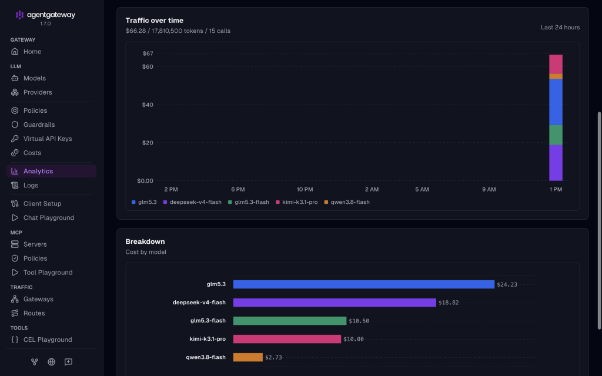
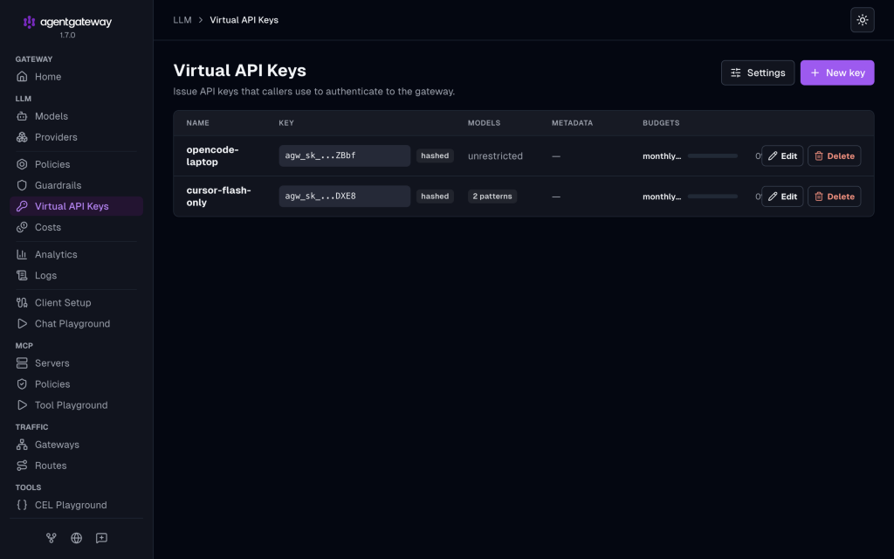
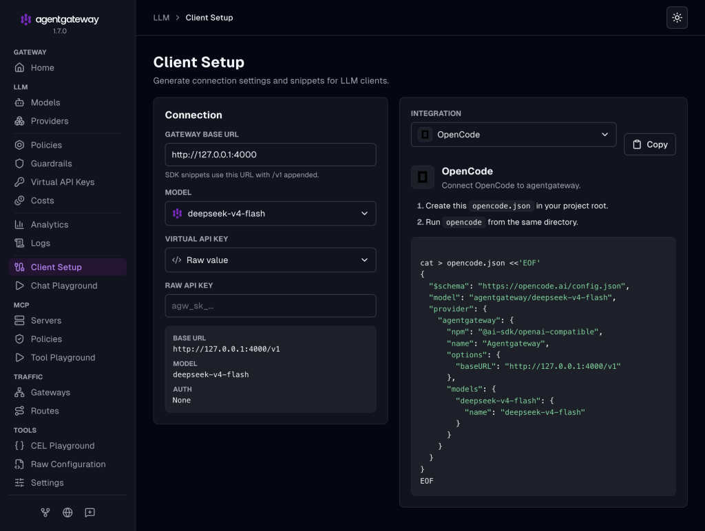

# AgentGateway for NaN Cloud

Run your own [agentgateway](https://agentgateway.dev) (v1.7.0, OSS) on [NaN Cloud](https://cloud.nan.builders/spaces) — pre-wired for the NaN Inference API (`api.nan.builders`) with zero YAML setup.



## Why run this?

- **Multiple Virtual API Keys** — issue separate keys per app (`opencode`, Cursor, Claude Code) or teammate without ever sharing your real `NAN_API_KEY`.
- **Budgets per API key (`$1 = 1 NaN credit`)** — agentgateway displays costs and budgets in `$`, and [config/model-catalog.json](config/model-catalog.json) maps **1 NaN credit = $1** (a 7,000-credit plan = `$7,000`, a `$500` budget = 500 credits, blocking overages with `429`).
- **Single MCP server to add everywhere** — configure remote MCP servers once in the UI and point all your editors/agents at one `/mcp` endpoint.
- **Add other providers alongside NaN** — plug in OpenAI, Anthropic, Gemini, or custom endpoints in the UI (built-in cost catalog preserved).
- **Custom rate limits & policies** — configure per-key/model rate limits, model allowlists, prompt guardrails, and CEL policies from the UI.
- **Zero-config NaN defaults** — pre-configured `NaN` provider, startup `/v1/models` auto-discovery, OpenAI/Anthropic/Responses/Embeddings support (even without `/v1`), and persistent SQLite on `/data`.

---

## Quick start

### 1. Fork & deploy on NaN Cloud

Fork `paurosello/nan-agentgateway` to your GitHub account (required by NaN Cloud's GitHub App; see [Keeping your fork up to date](docs/updating.md) to pull agentgateway upgrades and rate updates later). Then in [NaN Cloud](https://cloud.nan.builders/spaces), go to **Space → New App**:

| Setting | Value |
|---|---|
| Repository | your fork of `paurosello/nan-agentgateway` (branch `main`, `Dockerfile`) |
| Expose over HTTP | **On**, port **`4000`** |
| Persistent storage | **On** (required — creation-time option, mounted at `/data`) |
| Replicas | **`1`** (SQLite must not be shared across replicas) |
| Resources | `500m` / `512Mi` |
| Environment | `NAN_API_KEY` = your NaN API key *(tip: add it after step 3, or lock auth right away)* |

Wait for `Running`, then open `https://<app>-<space>.apps.nan.builders/ui`.

### 2. Lock the UI first

The UI is the admin plane — lock it before sharing the URL. Generate the Basic Auth YAML locally:

```sh
./scripts/htpasswd.sh <your-username>
```

Then in the UI: **Settings → UI → Basic auth**, toggle raw (`<>`) mode, paste the generated YAML block, and save.

### 3. Enable Virtual API Keys & mint a key

Never share your UI password or raw `NAN_API_KEY` with tools or teammates — give each app or person a virtual key instead:

**LLM → Virtual API Keys → Settings → Mode: `Strict` → `+ New key`**



Optionally attach a **USD budget** and **allowed models**. Because **`$1 = 1 NaN credit`**, setting a `$500` / 30d budget caps that key at **500 NaN credits** (out of your 7,000-credit allowance) and blocks further calls with `429`.

### 4. Point your AI clients at your gateway

Open **LLM → Client Setup** (`/ui/llm/client-setup`) to generate ready-to-paste configs for **OpenCode**, **Claude Code**, **Cursor**, **Codex**, and more using your virtual key (`agw_sk_...`):



Or test directly with `curl`:

```sh
curl https://<app>-<space>.apps.nan.builders/v1/chat/completions \
  -H "Authorization: Bearer agw_sk_..." \
  -H "content-type: application/json" \
  -d '{"model":"deepseek-v4-flash","messages":[{"role":"user","content":"hi"}]}'
```

- **opencode / Cursor / OpenAI SDK:** Base URL `https://<app>-<space>.apps.nan.builders/v1`, API key `agw_sk_...`
- **Claude Code (Anthropic Messages):** `ANTHROPIC_BASE_URL=https://<app>-<space>.apps.nan.builders`, `ANTHROPIC_API_KEY=agw_sk_...`
- **MCP clients:** `https://<app>-<space>.apps.nan.builders/mcp`

---

## Guides

| Guide | What it covers |
|---|---|
| [Budgets, Virtual Keys & NaN Credits](docs/budgets-and-keys.md) | 1 credit = $1 catalog, setting per-key credit caps (`429`), flash-only keys, metadata & Analytics |
| [Adding MCP Servers](docs/mcp.md) | Adding remote Streamable HTTP / SSE MCP servers, upstream auth, Tool Playground, and client setup |
| [Keeping Your Fork Up to Date](docs/updating.md) | 1-click GitHub Sync fork & CLI instructions to pull agentgateway upgrades and credit rate updates |
| [Full Self-Service & Operations Guide](docs/self-service.md) | OIDC/Basic auth details, Postgres, upgrading agentgateway, backups, troubleshooting & lockout recovery |
