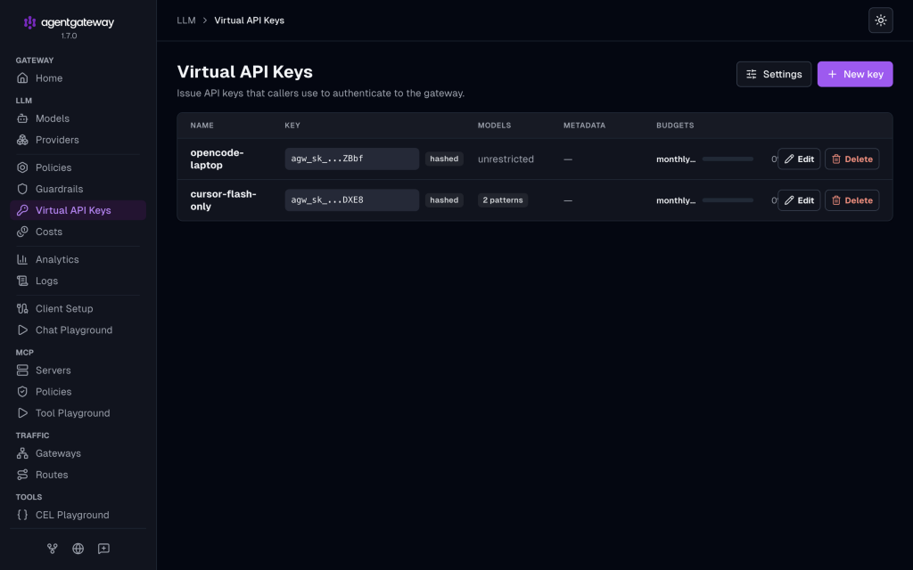
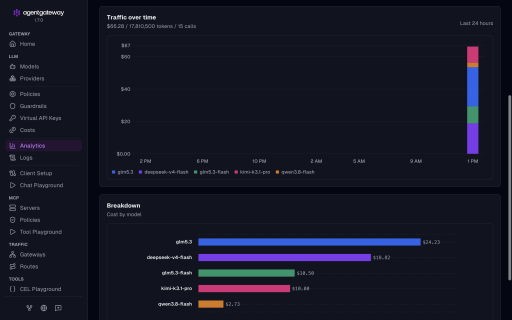
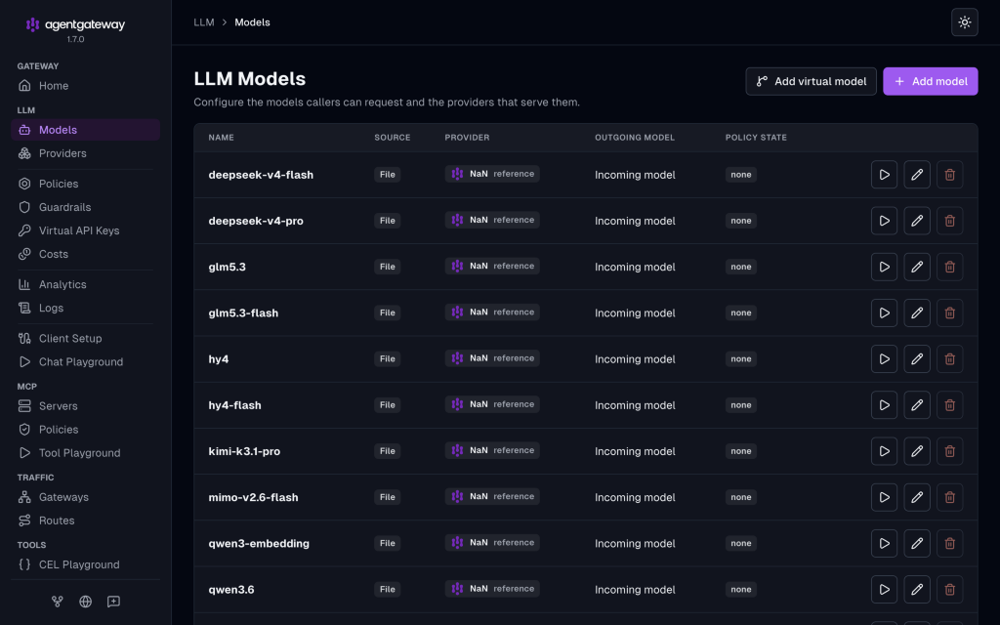

# Budgets, Virtual API Keys & NaN Credits

Virtual API Keys let you issue separate keys per app (`opencode-laptop`, `cursor-work`) or per teammate — each with its own **NaN credit budget**, **allowed models**, and **Analytics breakdown** — without ever exposing your real `NAN_API_KEY` or UI admin password.

## 1. Enable strict API key auth

1. Open **LLM → Virtual API Keys**.
2. Click **Settings** (or **Enable API key auth**) and set **Mode** to **`Strict`**.
   - `Strict` rejects any LLM/MCP request without a valid virtual key (`401 authentication failed`).
   - This protects the data plane (`/v1/*`, `/mcp`); `/ui` and `/api/*` are protected separately by **Settings → UI** ([details](self-service.md#2-lock-the-ui-first)).

## 2. How NaN credits map to `$` budgets (1 credit = $1)

`config/model-catalog.json` configures every NaN model's exact per-1M-token credit rates (`input`, `cacheRead`, `output`, and `cacheWrite`) with **1 NaN credit = $1**:

| Model | Input (cr/1M) | Cached (cr/1M) | Output (cr/1M) | Cache write (cr/1M) |
|---|---:|---:|---:|---:|
| `deepseek-v4-flash` | 10.50 | 0.21 | 42.00 | — |
| `glm5.3-flash` | 5.25 | 1.05 | 17.50 | — |
| `mimo-v2.6-flash` | 7.00 | 0.14 | 14.00 | — |
| `qwen3.8-flash` | 7.50 | 0.80 | 23.50 | — |
| `glm5.3` | 49.00 | 9.10 | 154.00 | — |
| `kimi-k3.1-pro` | 100.00 | 10.00 | 500.00 | 100.00 |
| `qwen3.8-max` | 100.00 | 12.50 | 300.00 | — |
| `qwen4-max` | 70.65 | 3.55 | 212.00 | — |
| `deepseek-v4-pro` | 66.00 | 2.20 | 198.00 | — |
| `hy4` | 41.70 | 2.10 | 125.05 | — |
| `hy4-flash` | 10.50 | 0.21 | 42.00 | — |
| `qwen3.6`, `gemma4`, `qwen3-embedding` | 0 | 0 | 0 | — |

Because 1 credit = $1:
- A NaN Member allowance of **7,000 credits** = **`$7,000`** in agentgateway.
- A key budget of **`$500` / 30d** caps that key at **500 credits per 30 days** (requests beyond the budget are blocked with `429`).
- **Analytics → Cost** displays credit spend directly per model, per key, or per user.

## 3. Create a key with a budget and model allowlist

Click **`+ New key`** in **LLM → Virtual API Keys**:

- **Name:** something descriptive, e.g. `opencode-laptop` or `alice-cursor`.
- **Budget:** add a **USD** rolling budget (e.g. `500` for 500 credits over `30d`, or `50` over `24h`). You can also combine it with a token budget.
- **Allowed models:** leave unrestricted for all models, or pick specific models (for example, restrict a shared key to flash models like `deepseek-v4-flash` and `glm5.3-flash` so it can't burn credits on `kimi-k3.1-pro` or `glm5.3`).
- **Metadata:** add key-value tags like `user: alice` or `client: opencode` so you can filter and group spend in **Analytics** and **Logs**.

Save and copy the generated `agw_sk_...` key — it is stored hashed and shown only once.

## 4. Available models & updating credit rates

On startup, `docker-entrypoint.sh` queries `https://api.nan.builders/v1/models` and registers every chat/embedding model your `NAN_API_KEY` can access (you can inspect them under **LLM → Models**).

- **New NaN models:** redeploy or restart the app to refresh the list. Even before restarting, the `*` catch-all routes any newly released model immediately.
- **Updated credit rates:** edit `config/model-catalog.json` in your fork and redeploy. Because `config/model-catalog.json` is an overlay, agentgateway's built-in pricing for other providers (OpenAI, Anthropic, Gemini, etc.) stays intact if you add them in the UI.
- **Disable startup discovery:** set `NAN_DISCOVER_MODELS=false` in the app's environment variables.
