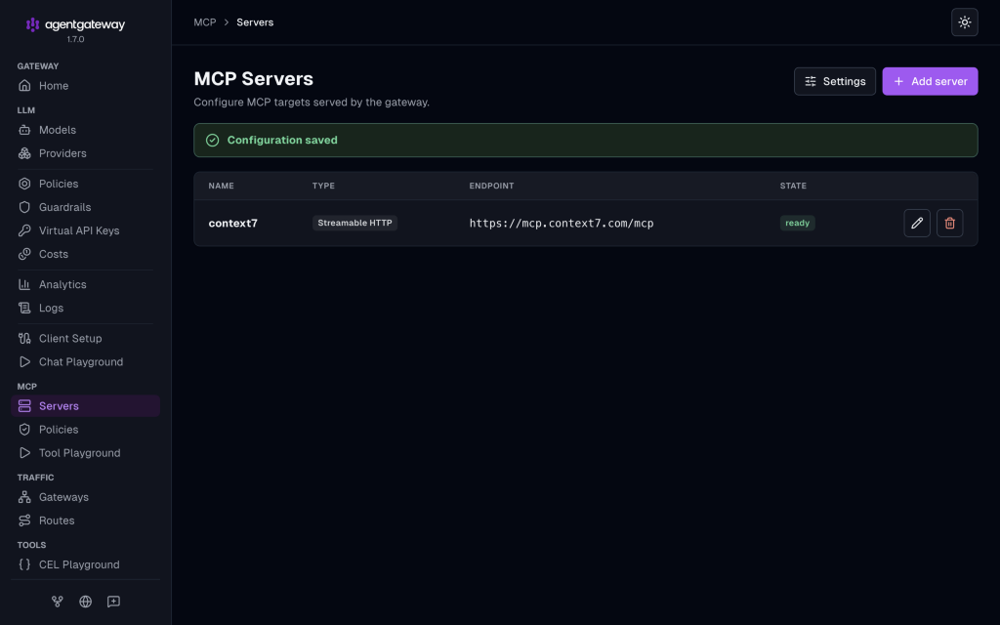

# Adding MCP Servers

Your gateway doubles as a centralized **MCP (Model Context Protocol) proxy**. Instead of configuring every MCP server and its API keys separately in `opencode`, Claude Code, and Cursor, add them once in agentgateway and point your clients at a single `/mcp` endpoint.



## 1. Add a remote MCP server

In the UI, open **MCP → Servers → `+ Add server`**:

- **Name:** short identifier (e.g. `context7`, `linear`, `github`). Tool names are namespaced by server name when multiple MCP servers are configured.
- **Type:** choose **Streamable HTTP** (recommended for modern remote MCP servers) or **SSE** (legacy Server-Sent Events).
- **Endpoint / URL:** the server's MCP URL, e.g. `https://mcp.context7.com/mcp`.

Click **Save**. The server appears in the list with state `ready` and is stored in `/data/agentgateway.db` (survives restarts and redeploys).

### Passing upstream credentials to an MCP server

If an MCP server requires an API key or Bearer token:
- Configure it on the server's **Auth / Headers** settings in **MCP → Servers** (or via **MCP → Policies**).
- Prefer referencing container environment variables (set in NaN Cloud App → Environment) where supported, rather than pasting raw secrets into multiple clients.

## 2. Test tools in the Tool Playground

Open **MCP → Tool Playground** in the sidebar to list every tool exposed by your connected MCP servers and invoke them interactively before wiring up your editor or agent.

## 3. Control access with MCP Policies

- **Authentication:** the gateway-level **Virtual API Key** policy (`LLM → Virtual API Keys → Settings → Strict`) protects **both** `/v1/*` and `/mcp`. Callers pass their `agw_sk_...` key as `Authorization: Bearer agw_sk_...`.
- **Tool filtering & authorization:** open **MCP → Policies** to restrict which tools a caller or virtual key metadata group can see or call (using CEL rules, which you can test in **Tools → CEL Playground**).
- **Session encryption:** agentgateway v1.7.0 encrypts MCP session IDs automatically using a session key stored in the database (nothing to configure).

## 4. Connect your clients

Point any MCP-compatible client at your gateway's Streamable HTTP endpoint:

- **URL:** `https://<app>-<space>.apps.nan.builders/mcp`
- **Header:** `Authorization: Bearer agw_sk_...`

Example JSON snippet (works with Claude Code, Cursor, opencode, and other Streamable HTTP MCP clients):

```json
{
  "mcpServers": {
    "nan-gateway": {
      "type": "http",
      "url": "https://<app>-<space>.apps.nan.builders/mcp",
      "headers": {
        "Authorization": "Bearer agw_sk_..."
      }
    }
  }
}
```
